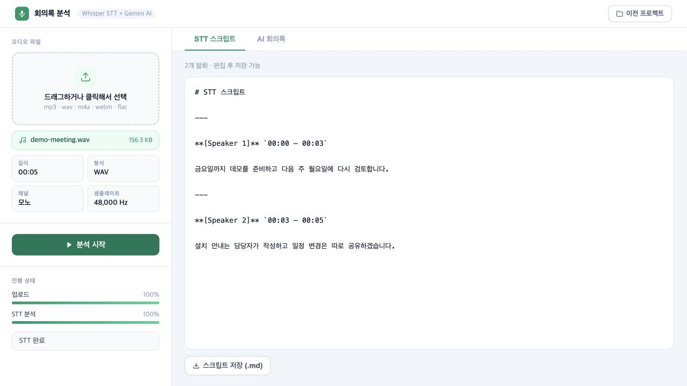
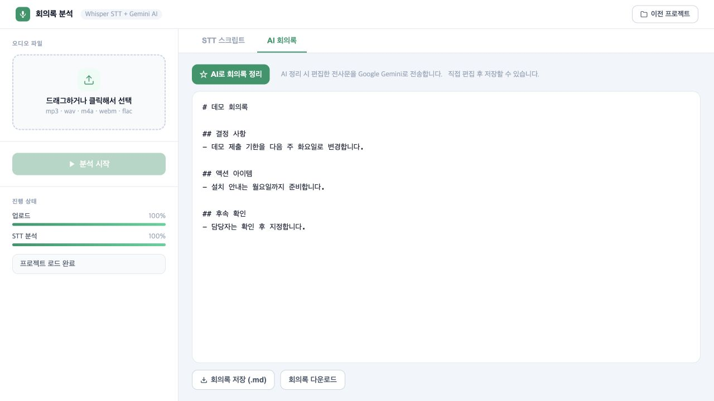

# Meeting Notes Generator

**회의 음성을 전사하고, 사람이 수정한 내용을 바탕으로 회의록을 만드는 개인 웹 도구**

음성 업로드부터 전사·화자 라벨·문서 편집·저장까지 한 화면에서 이어서 처리합니다. STT는 서버의 로컬 Whisper 모델을 사용하고, 사용자가 AI 정리를 요청하면 현재 편집한 전사문을 Gemini로 보내 지정한 Markdown 양식에 맞춰 정리합니다.

[실행 안내](docs/SETUP.md) · [구조와 설계](docs/ARCHITECTURE.md) · [개선·검증 기록](docs/VALIDATION.md)

## 사용 흐름

1. 녹음 파일을 업로드하고 처리 상태를 확인합니다.
2. 화자 라벨과 시간 구간이 있는 전사를 읽고 잘못 인식한 내용을 수정합니다.
3. **편집한 전사**로 AI 회의록을 생성합니다.
4. 결정 사항·담당자·기한을 사람이 확인하고 전사·회의록을 저장하거나 Markdown으로 내려받습니다.
5. 이전 프로젝트를 불러와 이어서 편집합니다.





위 화면은 합성 회의 내용과 테스트 처리기를 사용한 UI 검증 예시입니다. 실제 개인 녹음·회의 자료나 Gemini의 실제 응답을 공개한 화면이 아닙니다. 두 번째 화면은 예시 회의록을 직접 검토·편집한 상태입니다.

## 주요 기능

| 기능 | 구현 |
| --- | --- |
| 음성 처리 | faster-whisper STT, VAD, 반복 전사 필터, 음성 특징 기반 화자 군집화 |
| 진행 상태 | 업로드 진행률, 처리 단계, SSE 방송과 폴링 보완 |
| 문서 편집 | 전사·회의록 편집, 서버 저장, Markdown 다운로드 |
| AI 정리 | 편집 전사 반영, 템플릿 지정, 같은 입력의 생성 결과 캐시, 오류·출력 중단 처리 |
| 프로젝트 보관 | 메타데이터·녹음·문서의 파일 기반 저장, 재시작 후 결과 조회 |
| 처리 제한 | 음성 처리 작업 1개씩 실행, 대기열·용량 제한, 실패한 임시 업로드 정리 |

## 기술과 구조

- **API:** Python 3.12, FastAPI, uvicorn, Pydantic
- **STT·오디오:** faster-whisper, PyAV, librosa, NumPy
- **화자 추정:** 음성 특징 추출, scikit-learn 군집화
- **회의록:** Gemini REST API, httpx, Markdown 템플릿
- **웹:** HTML/CSS/Vanilla JavaScript
- **검증:** pytest, Ruff, GitHub Actions


```text
meeting_notes/       API, 작업 관리, 전사·화자 처리, 저장, AI 클라이언트
static/              HTML·CSS·JavaScript 화면
form.md              공개용 회의록 양식
tests/               회귀 테스트
docs/                실행·구조·검증 안내와 합성 예시 화면
requirements.txt     고정된 Python 의존성
.env.example         비밀 값이 없는 설정 예시
main.py              uvicorn 실행 진입점
```

## 실행

```bash
git clone https://github.com/ho72/meeting-notes-generator.git
cd meeting-notes-generator
python3.12 -m venv .venv
source .venv/bin/activate
python -m pip install -r requirements.txt
cp .env.example .env
uvicorn main:app --host 127.0.0.1 --port 8000
```

`http://localhost:8000`에서 사용합니다. 전사에는 Gemini 키가 필요하지 않으며, 최초 사용 시 Whisper 모델을 다운로드합니다. AI 회의록 생성에는 자신의 `GEMINI_API_KEY`와 사용 가능한 모델 설정이 필요합니다. [상세 설정](docs/SETUP.md)을 참고하세요.

## 개선과 확인한 범위

기존 단일 파일 구현에서 편집한 전사가 AI 입력에 반영되지 않던 문제, 짧은 입력의 화자 수 추정 오류, SSE 구독자의 이벤트 경쟁, 저장 이전 완료 표시 등을 수정했습니다. 기능별 코드를 분리하고 입력·저장·처리 제한과 재시작 후 조회를 보강했습니다.

2026-10-07 기준 회귀 테스트 **42개**, Python 정적 검사와 웹 JavaScript 문법 검사가 통과했습니다. 합성 음성을 이용해 CPU의 `tiny.en` 모델로 실제 STT·화자 처리 경로도 확인했습니다. [검증 조건과 한계](docs/VALIDATION.md)를 따릅니다.

## 사용 범위와 한계

- 현재는 **인증 없는 로컬·단일 사용자 도구**입니다. 계정별 접근 제어나 다중 사용자 데이터 분리는 구현하지 않았습니다. 기본 실행은 loopback 바인딩이며, 여러 uvicorn worker로 실행하는 구성은 지원하지 않습니다.
- 화자 구분은 MFCC 등 음성 특징의 군집화이며, 음성 임베딩 기반 전문 화자 분리나 실제 인물 식별 기능이 아닙니다. 짧은 발화·겹친 음성·잡음에서는 라벨이 부정확할 수 있습니다.
- STT와 LLM 결과는 원문 대조·사람의 검토가 필요합니다. 생성 결과의 정확도·누락률을 보장하거나 수치로 측정한 프로젝트가 아닙니다.
- AI 생성 버튼을 누르면 편집한 전사문이 Google로 전송되고 제공자 사용 요금이 발생할 수 있습니다. 실제 외부 Gemini 호출과 한국어 `medium` 모델의 품질 평가는 이번 검증에 포함하지 않았습니다.
- `data/`의 녹음·전사·회의록과 실제 `.env`는 공개 코드에 포함하지 않습니다. 이 공개본을 특정 회사의 운영 시스템과 동일한 구현으로 소개하지 않습니다.
